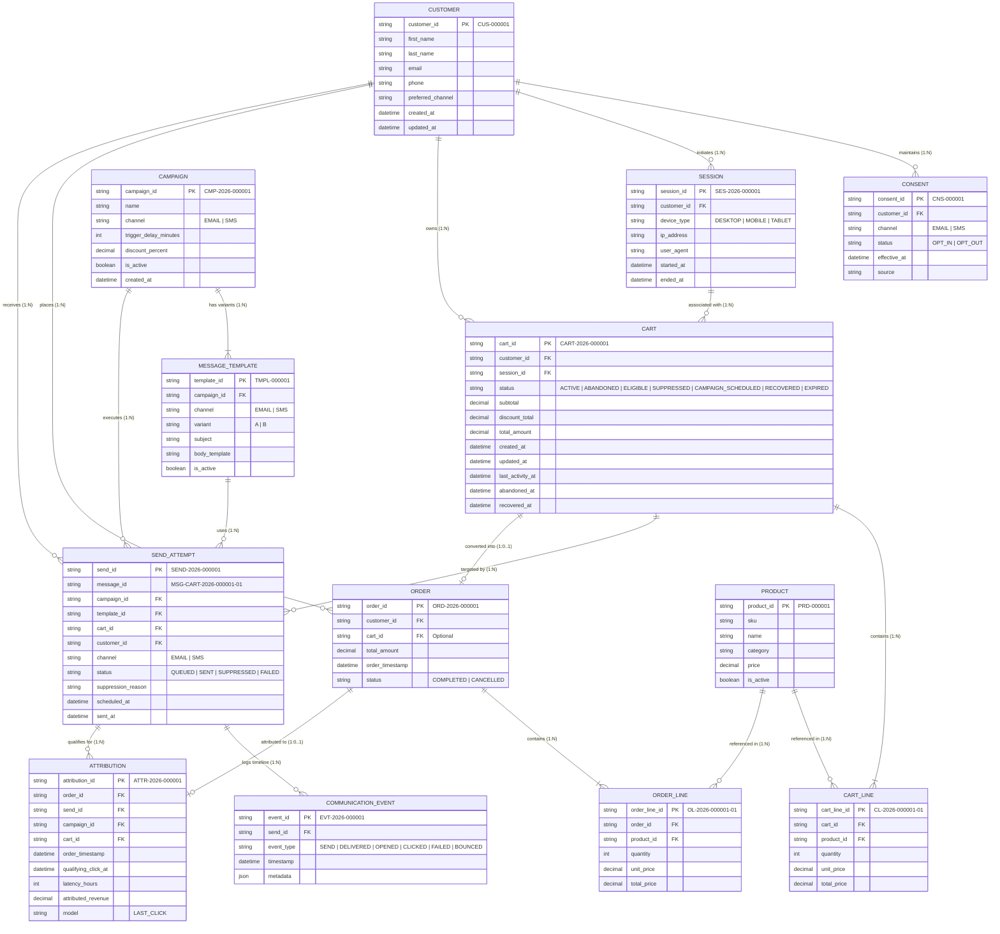

# E-Commerce Abandoned Cart Recovery & Campaign Attribution System
## Architectural Specification & Phased Engineering Blueprint

### 1. Executive Architecture Overview
The system is an enterprise-grade solution engineered to:
1. Detect cart abandonment based on configurable inactivity thresholds (default 60 minutes).
2. Validate customer communication consent across independent Email and SMS channels with effective date checking and withdrawal suppression.
3. Enforce frequency caps (maximum 3 recovery messages per customer per channel in a rolling 7-day window) and suppression rules.
4. Schedule and simulate multi-channel recovery campaigns (SEND, DELIVERED, OPENED, CLICKED, FAILED, BOUNCED).
5. Track subsequent orders and perform deterministic, non-double-counted Last-Click Attribution within a 7-day lookback window.
6. Synthetically generate realistic datasets (Starter: 2k carts, 800 abandoned; Full: 50k carts, 20k abandoned, ~10k sends) with fixed seed `20261022`.
7. Generate and detect 4 explicit labeled anomalies (`MESSAGE_AFTER_OPTOUT`, `CART_ABANDONED_AFTER_PURCHASE`, `DUPLICATE_ATTRIBUTION`, `STALE_CART_TOTAL`).
8. Provide an automated 16-point Data Quality Validation Suite, reproducible exports with SHA-256 manifests, RESTful APIs, and a 12-page React + TypeScript + Tailwind analytics dashboard.

---

### 2. Entity-Relationship Diagram (ERD)



---

### 3. Concrete Directory Structure

```
c:\Users\Admin\Downloads\AI_Farward_Deployeement\
├── backend/
│   ├── app/
│   │   ├── __init__.py
│   │   ├── main.py
│   │   ├── config.py
│   │   ├── database.py
│   │   ├── models/
│   │   │   ├── __init__.py
│   │   │   ├── customer.py
│   │   │   ├── consent.py
│   │   │   ├── session.py
│   │   │   ├── product.py
│   │   │   ├── cart.py
│   │   │   ├── campaign.py
│   │   │   ├── send_attempt.py
│   │   │   ├── communication_event.py
│   │   │   ├── order.py
│   │   │   ├── attribution.py
│   │   │   └── anomaly.py
│   │   ├── schemas/
│   │   │   ├── __init__.py
│   │   │   ├── customer.py
│   │   │   ├── cart.py
│   │   │   ├── campaign.py
│   │   │   ├── send_attempt.py
│   │   │   ├── order.py
│   │   │   ├── attribution.py
│   │   │   ├── analytics.py
│   │   │   └── validation.py
│   │   ├── services/
│   │   │   ├── __init__.py
│   │   │   ├── abandonment_engine.py
│   │   │   ├── consent_suppression_engine.py
│   │   │   ├── campaign_engine.py
│   │   │   ├── simulated_provider.py
│   │   │   ├── attribution_engine.py
│   │   │   ├── anomaly_service.py
│   │   │   └── analytics_service.py
│   │   ├── generator/
│   │   │   ├── __init__.py
│   │   │   ├── id_generator.py
│   │   │   ├── distributions.py
│   │   │   ├── synthetic_data_generator.py
│   │   │   └── anomaly_fixtures.py
│   │   ├── validation/
│   │   │   ├── __init__.py
│   │   │   ├── rules.py
│   │   │   └── validator.py
│   │   ├── exports/
│   │   │   ├── __init__.py
│   │   │   ├── exporter.py
│   │   │   └── manifest_generator.py
│   │   └── api/
│   │       ├── __init__.py
│   │       ├── router.py
│   │       ├── customers.py
│   │       ├── carts.py
│   │       ├── campaigns.py
│   │       ├── send_attempts.py
│   │       ├── orders.py
│   │       ├── attributions.py
│   │       ├── analytics.py
│   │       ├── validation.py
│   │       ├── anomalies.py
│   │       ├── generator.py
│   │       └── exports.py
│   ├── tests/
│   │   ├── __init__.py
│   │   ├── conftest.py
│   │   ├── test_generator.py
│   │   ├── test_abandonment_engine.py
│   │   ├── test_consent_suppression.py
│   │   ├── test_campaign_events.py
│   │   ├── test_attribution_engine.py
│   │   ├── test_anomalies.py
│   │   ├── test_validation_suite.py
│   │   ├── test_reproducibility.py
│   │   └── test_api_endpoints.py
│   ├── requirements.txt
│   └── alembic.ini
├── frontend/
│   ├── src/
│   │   ├── main.tsx
│   │   ├── App.tsx
│   │   ├── index.css
│   │   ├── types/
│   │   │   └── index.ts
│   │   ├── services/
│   │   │   └── api.ts
│   │   ├── components/
│   │   │   ├── Layout.tsx
│   │   │   ├── Navbar.tsx
│   │   │   ├── Sidebar.tsx
│   │   │   ├── KpiCard.tsx
│   │   │   ├── DataTable.tsx
│   │   │   └── StatusBadge.tsx
│   │   └── pages/
│   │       ├── OverviewDashboard.tsx
│   │       ├── CustomerManagement.tsx
│   │       ├── ConsentManagement.tsx
│   │       ├── CartManagement.tsx
│   │       ├── AbandonedCartMonitoring.tsx
│   │       ├── CampaignManagement.tsx
│   │       ├── MessageEventTracking.tsx
│   │       ├── OrderManagement.tsx
│   │       ├── ConversionAttribution.tsx
│   │       ├── AnomalyManagement.tsx
│   │       ├── DataValidation.tsx
│   │       └── DatasetExports.tsx
│   ├── package.json
│   ├── vite.config.ts
│   ├── tsconfig.json
│   └── tailwind.config.js
├── data/
│   ├── exports/
│   ├── reports/
│   └── manifests/
├── docs/
│   ├── architecture.md
│   ├── data_dictionary.md
│   ├── schema.md
│   ├── business_rules.md
│   ├── attribution_logic.md
│   ├── anomaly_catalog.md
│   ├── validation.md
│   ├── api_documentation.md
│   ├── reproducibility.md
│   └── source_manifest.md
├── scripts/
│   ├── init_db.py
│   ├── run_generator.py
│   └── run_reproducibility_test.py
├── README.md
├── .env.example
└── .gitignore
```

---

### 4. Phased Development Roadmap

| Phase | Milestone | Deliverables | Verification Strategy |
|---|---|---|---|
| **Phase 1** | Architecture & Planning | ERD, Directory Structure, Architecture Plan | Specification audit against all checklist items |
| **Phase 2** | Project Scaffold & Environment | Backend setup, requirements.txt, config, frontend Vite + React + TS + Tailwind setup | Imports and builds test |
| **Phase 3** | Database Models & Engine | SQLAlchemy models, schemas, relationships, constraints, SQLite + MySQL dual engine | Table creation test & schema verification |
| **Phase 4** | Synthetic Data Generator | Deterministic generator, seed `20261022`, Starter & Full modes, Anomaly injection | Unit tests for volume, distributions, and deterministic IDs |
| **Phase 5** | Core Business Logic Engines | Abandonment detector, Consent/Suppression engine, Campaign engine, Attribution engine | Unit & rule testing with deterministic asserts |
| **Phase 6** | Automated Validation & Anomaly Suite | 16-point validator, Anomaly detector, JSON/CSV reports, Ground truth generator | Validation checks and anomaly detection assertions |
| **Phase 7** | Exports & Reproducibility CLI | CSV/JSON/SQL exporters, SHA-256 manifests, CLI runner, reproducibility verification | Run twice with same seed -> verify 0 checksum diff |
| **Phase 8** | RESTful API (FastAPI) | All required endpoints, pagination, filters, swagger docs, error handling | Pytest API integration tests (HTTP 200/400/404) |
| **Phase 9** | Full Pytest Suite | Exhaustive test suite across engines, generator, APIs, anomalies, and reproducibility | 100% passing pytest runs |
| **Phase 10** | Enterprise Frontend Dashboard | 12 complete, interactive React pages with Recharts, Tailwind, Lucide, real API integration | Build & interactive API check |
| **Phase 11** | Comprehensive Documentation | README.md + 10 dedicated markdown docs in `/docs` | Complete coverage of operational & architectural manual |
| **Phase 12** | End-to-End Verification & Git Repo | Starter & Full generation verification, exports check, git commit | Production readiness check |
